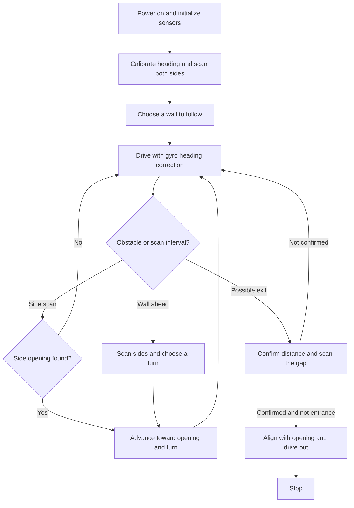

<div align="center">

# TOKASOZ — Autonomous Maze-Solving Car

**Infineon Student Challenge · 2026**  
**PSoC™ 6 · Embedded C · ModusToolbox™ · Robotics**

*A four-wheel robot that explores an unfamiliar maze using ultrasonic sensing, gyro-guided turns, and adaptive wall following.*

**🥈 2nd place in the hackathon car race**

</div>

---

## The challenge

Design an autonomous robot-car controller that can navigate a maze whose layout is not known in advance. The car needs to recognize walls, turn at corners, recover from dead ends, and distinguish a real exit from the entrance — all while relying on imperfect sensors and motor control.

Our solution runs directly on the PSoC 6 microcontroller. It does **not** require a camera, external computer, preloaded maze map, or wheel encoders. Instead, it combines a moving ultrasonic scan with orientation feedback from a gyroscope and a lightweight estimate of the vehicle's position.

### What the firmware does

- **Follows a wall dynamically.** At startup, the car compares its left and right sides and selects the closer wall to follow.
- **Looks for side openings.** The ultrasonic head scans periodically, including slow rolling scans when there is enough room in front.
- **Makes gyro-controlled turns.** Each turn uses a rotate → brake → settle → verify/correct sequence, with adjustments for motor stall and overshoot.
- **Avoids simple loops.** Repeated visits to the same approximate cell and heading can trigger a change of wall-following side.
- **Guards the entrance.** The default configuration treats the outward starting direction as the entrance, not an exit.
- **Checks potential exits.** A distant or missing front echo triggers further confirmation and a short angular sweep before the car drives out.
- **Recovers from trouble.** Back-off, obstacle re-scanning, stalled-turn detection, timeouts, and watchdogs help handle difficult situations.
- **Reports status.** On-board LEDs, debug UART, and optional BLE notifications expose the car's behavior while testing.

## How it works



This is a **wall-following strategy**, not full SLAM or complete graph search. It is designed for the hackathon course; it does not guarantee an exit in every possible maze (especially with disconnected wall islands or misleading sensor echoes).

## Hardware

| Component | Role |
| --- | --- |
| **Infineon PSoC 6** (`CY8CPROTO-063-BLE`) | Dual-core controller for navigation and Bluetooth |
| **4-wheel robot chassis and motor driver** | Vehicle movement and differential steering |
| **PCA9685-based motor control** | I²C-controlled PWM outputs for motor driving |
| **HC-SR04 ultrasonic sensor** | Measures obstacle distances in front and on either side |
| **Pan/tilt servo head** | Rotates and tilts the ultrasonic sensor for scanning |
| **MPU6050 inertial sensor** | Gyroscope feedback for turns and heading correction |
| **Addressable LED strip** | Visual status indication |
| **BLE / Nordic UART Service** | Optional wireless diagnostics and command relay |

The PSoC 6 application is split across its two cores:

- **Cortex-M4 (`proj_cm4/`)** — autonomous navigation, ultrasonic sensing, gyro control, motors, servo head, and state machine.
- **Cortex-M0+ (`proj_cm0p/`)** — BLE stack and communication with the Cortex-M4 through IPC.

For hardware connections, see the [API and hardware manual](doc/API_UserManual.md) and the [pin-assignment diagram](doc/drawing/PortsAndPins_Assignment_2026.JPG).

## Repository layout

```text
student-challenge-main/
├── proj_cm4/
│   ├── main.c                 # TOKASOZ autonomous maze navigation
│   ├── drivers/               # Ultrasonic, IMU, PWM, servo drivers
│   ├── modules/               # Motors, motion, distance, head, LEDs, IPC
│   └── deps/                  # ModusToolbox dependency references
├── proj_cm0p/                 # BLE firmware for the second CPU core
├── cores_shared/              # Shared CM0+ / CM4 communication types
├── bsps/                      # Target board support and device config
├── linker_scripts/            # Custom dual-core linker scripts
├── doc/                       # Hardware and API documentation
├── INSTALL.md                 # Full setup guide
├── Makefile                   # Top-level dual-core build
└── README.md
```

Generated build files, downloaded third-party libraries, and installer binaries are intentionally excluded from this repository. The `.mtb` references and lockfiles retain the information needed to download dependencies again.

## Build and flash

### Requirements

- **ModusToolbox Tools Package 3.9 or newer**, including Arm GCC and programming tools
- **PSoC 6 BLE Prototyping Kit** (`CY8CPROTO-063-BLE`) connected via USB
- Git and an internet connection to retrieve dependencies
- Optional: Visual Studio Code for editing and debugging

Detailed Windows, Linux, and VS Code instructions are in [INSTALL.md](INSTALL.md).

1. Open **modus-shell** and switch to the repository root.
2. Download the required libraries and generate the IDE workspace, if needed:

   ```bash
   make getlibs
   make vscode
   ```

3. Compile **both** cores:

   ```bash
   make build -j8
   ```

4. Connect the board and program the firmware:

   ```bash
   make program
   ```

> **Before the first run:** Raise the wheels for a direction test, verify the motor wiring and gyro sign, and make sure the car can be stopped immediately. Place the car facing **into** the maze and keep it still during startup. Sensor thresholds and motor behavior are specific to the hackathon chassis.

## Navigation settings

The main tuning parameters are near the top of [`proj_cm4/main.c`](proj_cm4/main.c):

| Parameter | Default | Meaning |
| --- | ---: | --- |
| `FOLLOW_SIDE` | `0` | Automatically select nearer wall (`1` left / `-1` right) |
| `DRIVE_SPEED` | `2000` | Nominal motor command while driving |
| `FRONT_STOP_MM` | `350` | Obstacle threshold in front of the car |
| `WALL_MM` | `450` | Side reading below which a wall is recognized |
| `OPEN_MM` | `560` | Side reading above which a gap is recognized |
| `SIDE_PEEK_EVERY_MM` | `250` | Approximate distance between side scans |
| `CELL_MM` | `560` | Maze cell spacing used for position estimates |
| `TURN_TOLERANCE_DEG` | `9` | Preferred settled-turn angular error |
| `EXIT_FAR_MM` | `2600` | Distant front reading considered exit-like |
| `EXIT_ON_ENTRANCE_SIDE` | `0` | Assume the exit is **not** on the entrance-facing outer wall |
| `START_DELAY_MS` | `3000` | Stillness/startup delay before autonomous movement |

These numbers are **calibrated assumptions**, not universal constants. In particular, change `CELL_MM`, opening thresholds, motor polarity, and the entrance-side policy when using a different course or chassis.

### Diagnostics

Set `TURN_TEST_MODE` or `RIGHT_TURN_ONLY_TEST` to `1` in `main.c` only when performing the corresponding controlled test. Return these flags to `0` for autonomous navigation.

For logs, connect a serial terminal to the board's KitProg USB-UART at **115200 baud (8-N-1)**. `RETARGET_CORE` in `common.mk` controls which core owns debug UART. BLE notifications can also relay navigation logs when enabled.

## Notes and limitations

- The algorithm uses **wall following** with basic loop mitigation; it does not build a complete maze map.
- Position is estimated from elapsed driving time and measured wall distances, **not** wheel encoders, so error can accumulate.
- A missing ultrasonic echo may indicate open space, but may also be a sensor failure or poor reflection; the code uses confirmation checks and timeouts to reduce false decisions.
- The default entrance guard assumes that a valid exit does not lie on the same outward-facing boundary as the entrance.
- This is a hackathon robotics project. Run it **under supervision**, on a clear course, and test hardware safety before full-speed operation.

## Team TOKASOZ

**Code developed by:**

- **Rudenko Kateryna**
- **Lesivtsiv Solomiya**
- **Yakubovska Antonina**
- **Leskiv Zlata-Antonina**

Developed as a team project for the **Infineon Student Challenge 2026**. 🏎️

## Acknowledgements and licensing

Built on the Infineon/Cypress PSoC 6 hackathon project template, ModusToolbox components, and the provided robot-car drivers. The original platform code and related materials are subject to their respective licenses; consult the repository's [LICENSE](LICENSE), board-package notices, and dependency licenses before reuse or redistribution.
